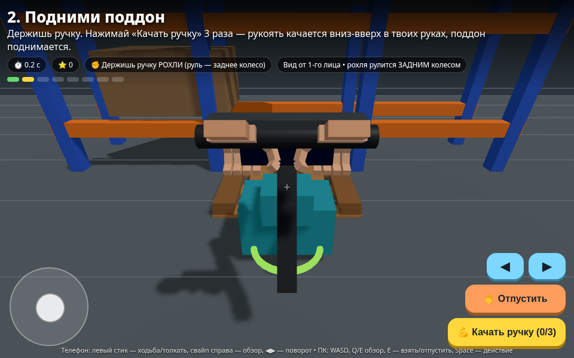

# Warehouse Game — Склад: рохля, поддон и стреппинг-лента

Браузерный концепт игры для телефона от первого лица: простые руки без перчаток хватаются за ручки, рохля рулится задним поворотным колесом у рукояти (зад уходит первым, вилы догоняют с запаздыванием), а тележка со стяжкой подъезжает к поддону лицевой частью — бабиной с лентой вперёд, бабина раскручивается при протяжке.



## Играть

- **GitHub Pages:** откройте Pages-ссылку этого репозитория на телефоне или ПК (адрес вида `https://alekseichmsk.github.io/warehouse-game/`).
- **Локально:** `python3 -m http.server 8765` в корне репозитория → `http://localhost:8765/`; на телефоне — IP компьютера в той же Wi‑Fi сети, порт 8765.
- Нужен интернет только для библиотеки Three.js с CDN.

## Как играть (управление)

- **Телефон:** левый виртуальный джойстик — ходьба / толкать-тянуть взятый объект; свайп по правой половине экрана — обзор; кнопки ◀ ▶ — поворот; **«Взять/Отпустить»** — руки хватаются за ручку рохли/тележки, нож или стреппер; жёлтая кнопка — контекстное действие этапа.
- **ПК:** WASD/стрелки — движение, Q/E — поворот/взять-отпустить (также свайп мышью по правой части экрана), Space — действие.

**Этапы:** 1) взять рохлю и завести вилы под поддон под стеллажом → 2) качнуть ручку ×3 (поднять) → 3) вывезти поддон на жёлтую площадку, руля задом → 4) рычагом опустить поддон, отпустить рохлю → 5) подкатить тележку **бабиной вперёд** к поддону → 6) положить изолон, взять нож, отрезать полоску → 7) протянуть ленту (бабина крутится) → 8) взять стреппер двумя руками и затянуть. Работают таймер и очки.

Файлы: `index.html` — игра v2 (актуальная), `index_v1.html` — первая версия, `game_v2_*.png` / `game_preview.png` — скриншоты.

## 3D-модели (`models/`, GLB)

Игровые low/mid-poly модели из Blender, суммарно ~6.7 MB — можно импортировать в Unity / Unreal / Godot:

- `pallet_jack.glb` — рохля, `pallet.glb` — евро-поддон, `pallet_jack_with_pallet.glb` — рохля с поддоном
- `strap_cart.glb` — тележка с бабиной ленты, `strapping_tool.glb` — стреппинг-инструмент (затягивалка)
- `rack.glb` — стеллаж, `knife.glb` / `knife_retracted.glb` — канцелярский нож
- `izolon_thin.glb` / `izolon_wide.glb` / `izolon_both.glb` — Изолон НПЭ рулонами, `izolon_roll_strips.glb` / `izolon_strip_single.glb` / `izolon_strips_pile.glb` — рулон и полоски изолона
- `hands_simple_open.glb` / `hands_simple_grip.glb` — простые руки от первого лица без перчаток (5 пальцев), `hands_*.glb` — варианты с предметами
- `tape_*.glb`, `warehouse_set.glb` — ранние рулоны изоленты и общий набор

---
# Склад v2: от первого лица — рохля, тележка, стреппер

Браузерный концепт для телефона. Один файл `index.html` (Three.js с CDN, нужен интернет для библиотеки).
Старая версия сохранена как `index_v1.html`.

## Запуск
```
cd /workspace/warehouse_game && python3 -m http.server 8765
```
Открыть: http://localhost:8765/ — на телефоне: IP компьютера в той же Wi‑Fi сети, порт 8765.
Скриншоты: `index.html?demo=grip` (хват за ручку рохли), `index.html?demo=cart` (тележка бабиной к поддону).

## Что нового в v2
- **Вид от первого лица**: камера — глаза игрока, игрок ходит пешком.
- **Простые руки без перчаток**: цвет кожи, low-poly, ладонь + 5 пальцев по 3 сегмента, ногти. Руки видны внизу кадра.
- **Хват руками**: подойди к ручке/инструменту → кнопка «Взять». Руки тянутся и обхватывают ручку (пальцы сжимаются) и остаются на ней, пока держишь. «Отпустить» — руки отпускают.
- **Рохля — заднее руление**: рулевое колесо сзади у рукояти. Пока держишь ручку: стик вверх/вниз — толкать/тянуть, влево/вправо — рукоять наклоняется, заднее (красное) колесо поворачивается, зад рохли уходит в сторону первым, вилы разворачиваются следом с запаздыванием. Качать ручку — рукоять качается в руках; рычаг опускает поддон.
- **Тележка — бабиной вперёд**: лицевая часть — бабина с лентой. Игрок за ручкой сзади, бабина едет первой к поддону; при протяжке бабина раскручивается, лента идёт под поддон.
- **Нож и стреппер берутся руками**: нож — на поддоне после укладки изолона («Резать» — рука с ножом идёт вдоль края), стреппер — на тележке («Затянуть» — инструмент вибрирует на ленте, обвязка стягивается).

## Управление
- Телефон: левый джойстик — ходьба / толкать-тянуть объект; свайп по правой половине экрана — обзор; кнопки ◀ ▶ — поворот; «Взять/Отпустить», жёлтая кнопка — контекстное действие.
- ПК: WASD/стрелки — движение, Q — поворот влево (и свайп мышью по правой части), E — взять/отпустить, Space — действие.

## Этапы
1. Взять рохлю → вилы под поддон под стеллажом 2. Качать ручку ×3 3. Вывезти на жёлтую площадку 4. Рычаг вниз, отпустить, отойти 5. Тележку бабиной к поддону 6. Изолон → взять нож → отрезать полоску 7. Протянуть ленту (бабина крутится) 8. Взять стреппер → затянуть. Таймер и очки сохранены.
